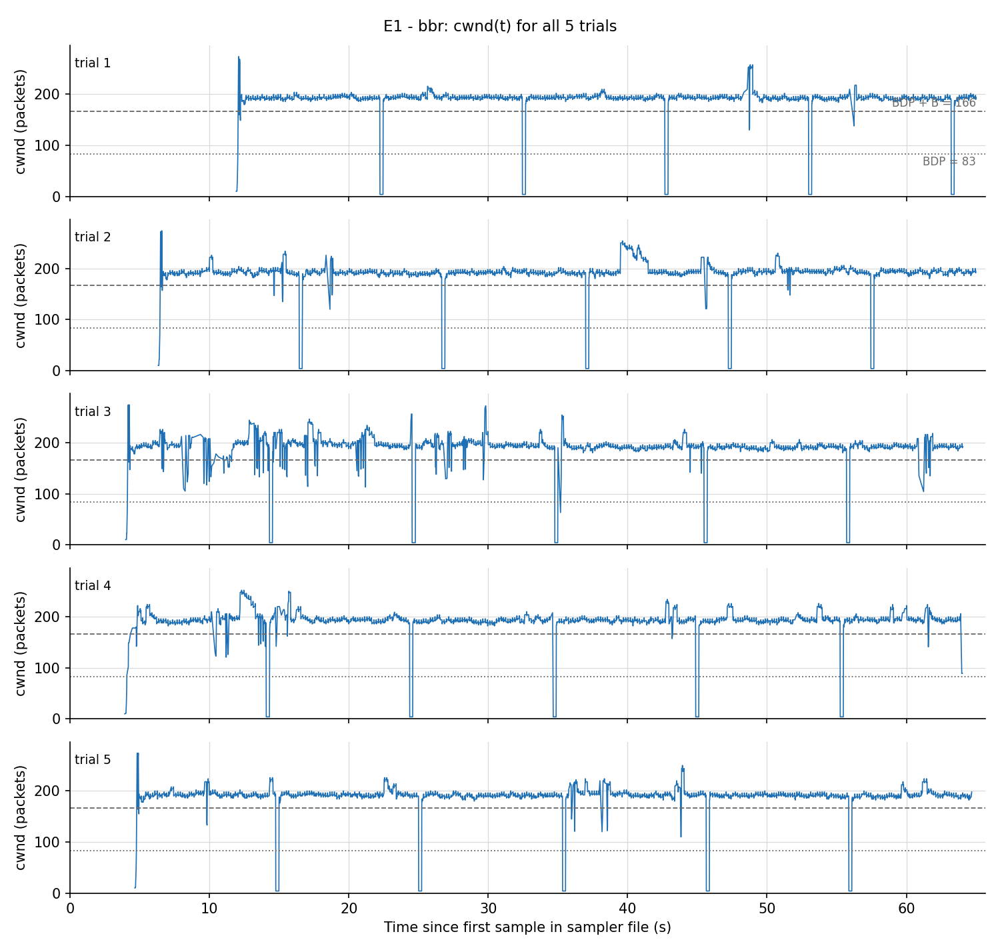

## Setup

### Environment

Mininet runs on Linux only. If you use macOS or Windows, use [Multipass](https://canonical.com/multipass) to run an Ubuntu VM:

```bash
multipass launch --name cc --cpus 2 --memory 4G --disk 10G   # create the VM
multipass shell cc                                           # open a shell inside it
multipass transfer dumbbell.py cc:                           # copy a file from your machine into the VM
```

Inside the Ubuntu VM, install the tools and load BBR:

```bash
sudo apt update
sudo apt install mininet openvswitch-switch iperf3 ethtool
sudo modprobe tcp_bbr                                # load the BBR kernel module (Reno and CUBIC are built in)
sysctl net.ipv4.tcp_available_congestion_control    # must list reno cubic bbr
```

### Apple Silicon Macs only: keep the VM's CPUs awake

When a VM CPU goes idle, macOS wakes it late, so netem's delays (and BBR's pacing) fire tens of milliseconds late. Before using Mininet, open a second VM shell (`multipass shell cc`), run this, and leave that shell open:

```bash
for i in $(seq $(nproc)); do chrt -i 0 sh -c 'while :; do :; done' & done   # one busy loop per VM CPU
```

`chrt -i 0` runs the loops at the lowest scheduling priority, so they only use CPU time that nothing else wants. Stop them when you are done:

```bash
pkill -f 'while :'
```

## E1 — Single flow, cwnd(t)

### A. Reno

### 1. Regenerating the Plot

**Requirements:** Python ≥ 3.8 and matplotlib.

Install matplotlib:

```bash
pip install matplotlib
```

Run the following command from the `project-cc` directory. It reads every
`data/e1/e1_b1_reno_t*_ss.txt` file and writes `plots/e1_reno_cwnd_all.png`:

```bash
python3 e1/analyze_e1.py --algo reno
```

#### Extraction Rules

- **Time origin (`t0`):** The first timestamp in the file.
- **Sample:** One timestamp and all sockets listed after it, up to the next timestamp.
- **Data socket:** The connection identified by its local and peer addresses and ports with the largest `bytes_acked` value across the entire file. This connection is then tracked in every sample, including early samples before it has acknowledged much data.
- **Missing data:** Samples without the data socket are dropped. Missing `cwnd` values are never replaced with zero or interpolated.
- **Time precision:** `time_s = timestamp − t0` is computed using `decimal.Decimal` to preserve the recorded timestamp precision.

### 2. Plot

The dashed line marks BDP + B = 166 packets (the point where the queue overflows). The dotted line marks BDP = 83 packets.


### 3. Steady-State Throughput: Mean and Standard Deviation

For each trial, steady-state throughput is calculated by averaging the per-interval throughput values, excluding intervals that start before 5 seconds. The mean and sample standard deviation are then calculated across the five trial results.

Run:

```bash
python3 e1/throughput_e1.py --algo reno
```

Output:

```text
t1: 47.57 Mbps
t2: 46.28 Mbps
t3: 46.27 Mbps
t4: 46.08 Mbps
t5: 45.66 Mbps
Mean ± SD: 46.37 ± 0.71 Mbps
```

Link utilization is calculated as:

$$
U = \frac{\bar{x}}{C} \times 100\%
  = \frac{46.37}{50} \times 100\%
  = \boxed{92.74\%}
$$

Here, $\bar{x}$ is the mean steady-state throughput and $C$ is the bottleneck capacity, both in Mbps.

Reno achieved a steady-state throughput of **46.37 ± 0.71 Mbps** across five trials, equivalent to **92.74%** of the 50 Mbps bottleneck capacity. This result is consistent with application throughput being lower than link capacity due to protocol overhead and congestion control behavior.

### 4. Trends and Deviations

**Setup and model.** C = 50 Mbps, RTT_min = 2 × 10 ms = 20 ms, so BDP = 50 Mbps × 20 ms / (1500 B × 8) ≈ 83 packets, and the buffer is B = 1 BDP = 83 packets. In the model, a single Reno flow fills the queue when cwnd reaches BDP + B = 166 packets. The next loss halves cwnd to 83 = BDP. Reno then adds 1 packet per RTT until the queue overflows again.

#### Trends

1. **AIMD sawtooth between BDP and BDP + B.** After slow start, cwnd rises to 166 packets, halves to 83, and repeats. In trial 1, 17 of the 19 cycles after slow start peak at exactly 166 and fall to exactly 83, the values the drop-tail model predicts.

2. **Each ramp curves (concave) instead of rising in a straight line.** A straight ramp assumes a constant RTT. Here, every packet above the BDP waits in the bottleneck queue. RTT therefore grows from 20 ms at cwnd = 83 to 40 ms at cwnd = 166, a full queue being 83 packets × 0.24 ms = 20 ms. Reno adds one packet per RTT, so in packets per second it grows half as fast at the top of a ramp as at the bottom.

3. **The sawtooth period is about 2.6 s.** Integrating dW/dt = 1/RTT(W), with RTT(W) = RTT_min × W / BDP, from 83 to 166 gives a period of RTT_min / (2·BDP) × (166² − 83²) ≈ 2.48 s.

#### Deviations

- **Many losses happened earlier than expected.** In some cycles, cwnd dropped before reaching the predicted 166 packets. Trial 1 had only 2 early losses, while trials 2–5 had 8–15 and lower throughput.

  VM scheduling delays may have caused packets to arrive in bursts and fill the queue early. Trials 4–5 each had 16 sampler gaps longer than 50 ms, compared with none in trial 1. This supports scheduling delays as a possible explanation, but does not prove they caused the losses. Cycle counts also cover different durations, so they are not directly comparable across all trials.

- **Troughs below 83 packets are still Reno's normal halving.** Each deep trough is half of the lower peak before it: 103 → 52 and 107 → 53 in trial 4, and 118 → 59 and 127 → 64 in trial 5. Reno behaves correctly; only the point where loss happens moves. While cwnd is below the BDP the queue is empty and the link is briefly idle, so the trials with more of these cycles have lower throughput.

- **The empty stretch at the left of each panel comes from how the sampler was timed.** `t = 0` is the sampler's first timestamp, not the start of the flow. The sampler started 5–17 s before iperf3: about 5 s for trials 3–5, and 15–17 s for trials 1–2. Trials 4–5 were re-run with the sampler running for the whole flow, so they capture all 59–60 s of it. Trials 1–3 stopped early and cover only 48–50 s.

### B. Cubic

### 1. Regenerating the Plot

Run the following command from the `project-cc` directory. It reads every
`data/e1/e1_b1_cubic_t*_ss.txt` file and writes `plots/e1_cubic_cwnd_all.png`:

```bash
python3 e1/analyze_e1.py --algo cubic
```

The dashed line marks BDP + B = 166 packets (the point where the queue overflows). The dotted line marks BDP = 83 packets.


### 2. Throughput

```bash
python3 e1/throughput_e1.py --algo cubic
```

Output:

t1: 41.82 Mbps
t2: 46.92 Mbps
t3: 47.68 Mbps
t4: 46.36 Mbps
t5: 46.12 Mbps
Mean ± SD: 45.78 ± 2.29 Mbps

Link utilization is calculated as:

$$
U = \frac{\bar{x}}{C} \times 100\%
  = \frac{45.78}{50} \times 100\%
  = \boxed{91.56\%}
$$

### 3. Trends and Deviations

#### Trends

- **Reductions are ×0.7:** The cwnd typically goes 166 → 116 (Reno goes 166 → 83).
- **The ramps fit the cubic curve:** In clean cycles, cwnd stays on average within 0.7–1.8 packets of 0.4(t − 5)³ + 166.
- **The period is about 3.4 s, not K = 5 s.**

#### Deviations

- **Many losses came early:** We expected that every loss happens at about 166 packets. In some trials most losses happen early. Trial 1, for example, had 18 early losses and only 6 full ones. One likely reason is that the VM does not run at a perfectly steady speed. When it pauses for a moment, packets pile up and then leave all at once as a burst. A burst can fill the 83-packet queue before cwnd reaches 166. It can be seen that trial 1 has the most gaps and the most early losses, while trials 3 and 4 have almost no gap and few early losses.

- **Few clean cycles are clean:** We expected most cycles are clean, but trial 5 has only 4. A clean cycle needs two full losses in a row. One early loss breaks two cycles at once: the cycle it ends and the cycle it starts. In trial 5 the full losses are scattered between early ones, so few of them are back to back

- **cwnd sometimes falls below the BDP:** After a loss, we expected the BDP = 0.7 x 166 = 116 (>83). However, in some trials, cwnd falls to 62-75. It may be because of several losses happening close together, and each one multiplies cwnd by 0.7 again.

- **Cubic was not clearly better than Reno:** We expected that Cubic should beat Reno. However, we observed that results, on average, were about the same: CUBIC 46.26 Mbps vs Reno 46.37 Mbps. It may come from the 1st trial (41.82Mbps), which pulls CUBIC's average down.

### C. BBR

### 1. Regenerating the Plot

Run the following command from the `project-cc` directory. It reads every
`data/e1/bbr/e1_b1_bbr_t*_ss.txt` file and writes `plots/e1_bbr_cwnd_all.png`:

```bash
python3 e1/analyze_e1.py --algo bbr
```

The dashed line marks BDP + B = 166 packets (the point where the queue overflows). The dotted line marks BDP = 83 packets.



### 2. Throughput

```bash
python3 e1/throughput_e1.py --algo bbr
```

Output:

```text
t1: 46.31 Mbps
t2: 46.29 Mbps
t3: 43.65 Mbps
t4: 45.09 Mbps
t5: 45.90 Mbps
Mean ± SD: 45.45 ± 1.12 Mbps
```

Link utilization is calculated as:

$$
U = \frac{\bar{x}}{C} \times 100\%
  = \frac{45.45}{50} \times 100\%
  = \boxed{90.90\%}
$$

BBR achieved **45.45 ± 1.12 Mbps** across five trials, **90.90%** of the 50 Mbps bottleneck. That is a little lower than Reno (46.37 Mbps) and CUBIC (46.26 Mbps). The reasons are explained in the Deviations below.

### 3. Trends

- **No sawtooth: cwnd is almost flat:** after Startup, cwnd stays at about **190–196 packets** in all five trials. It does not climb and drop like Reno and CUBIC. BBR does not react to loss, so there is no "grow until loss, then cut" cycle. It sends at the measured link speed and keeps that steady.

- **ProbeBW gain cycling shows up exactly as expected:** We expected that in the 8-step cycle, gain 1.25 should take 1/8 of the time (12.5%), 0.75 another 1/8 (12.5%), and gain 1 the other 6/8 (75%). Here is what we observed:

  | pacing_gain | Expected | Measured (5 trials) |
  | ----------- | -------- | ------------------- |
  | 1.25        | 12.5%    | 12.4–13.1%          |
  | 0.75        | 12.5%    | 11.9–12.3%          |
  | 1           | 75%      | 74.8–75.7%          |

- **ProbeRTT dips every 10 seconds:** We expected that every 10 s, cwnd drops to 4 packets for about 200 ms. We observed that very trial has exactly **5 dips** (25 in total). These are the deep, narrow drops to the bottom of each panel.

- **BBR measures the link correctly and keeps the queue small:**
  - **BtlBw ≈ 48.2 Mbps** in every trial, not 50. The link counts full Ethernet frames (1514 bytes), but BBR counts only the TCP data in them (1448 bytes): 50 × 1448 / 1514 ≈ 47.8 Mbps, very close to 48.2.
  - **RTprop = 20.0 ms** in every trial, exactly 2 × 10 ms.
  - **The RTT stays low:** the median RTT is **23.7–26.4 ms**, so the queue holds only about 4–6 ms of data, or about 15–25 packets. Reno and CUBIC filled the whole 83-packet queue, so their RTT went up to about 40 ms. **Low delay is BBR's main advantage.**

### 4. Deviations

- **cwnd is about 194, not 2 × BDP = 166:** We expected cwnd = 2 × BDP = 166 packets. We observed that cwnd sits at about **192–194 packets** (median) in every trial. It may because Linux BBR adds a small allowance on top of 2 × BDP. It covers packets that are sent in small batches and ACKs that arrive in bunches, which happens a lot in a VM.

- **Losses during steady state, and spikes in cwnd:** We expected that after Startup, BBR should lose almost nothing. However, some trials have many retransmissions after Startup, from 41 in trial 1 to 640 in trial 3. It may be because of the VM's pauses. When the VM stops for 100–500 ms, ACKs stop arriving and BBR's steady pacing breaks. When the VM wakes up, a burst of packets is sent at once. Here cwnd (≈194) is **larger** than what the link plus queue can hold (166), so cwnd cannot stop such a burst from overflowing the queue, and packets are lost.

- **BBR's throughput is a little lower than Reno's and CUBIC's:** We expected that BBR should use the link about as well as the others, but with a much shorter queue. However, BBR averages 45.45 Mbps, compared with 46.37 (Reno) and 46.26 (CUBIC). There are twom main reasons:
  1. **ProbeRTT costs time:** for about 0.21 s out of every ~10.2 s (about 2%), cwnd is only 4 packets and the link is mostly idle. That alone costs roughly 1 Mbps.
  2. **VM pauses:** the noisiest trials lose the most. Trial 3 (34 gaps) has the lowest throughput, 43.65 Mbps. The two quietest trials (1 and 2) reach 46.3 Mbps, about the same as Reno and CUBIC.
