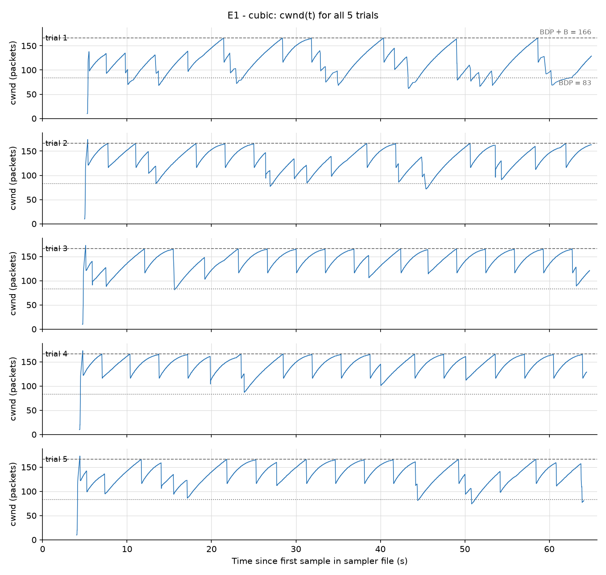
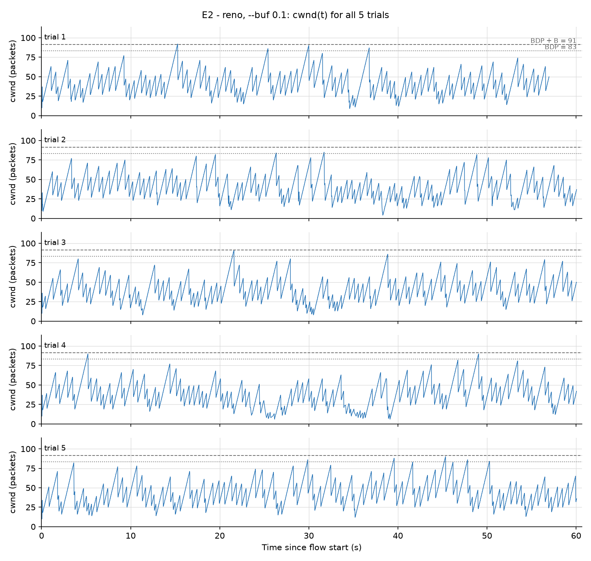
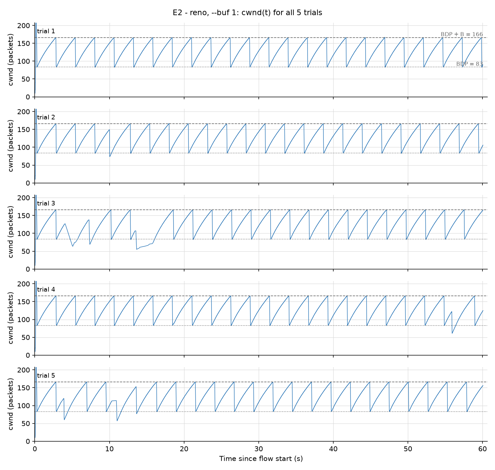
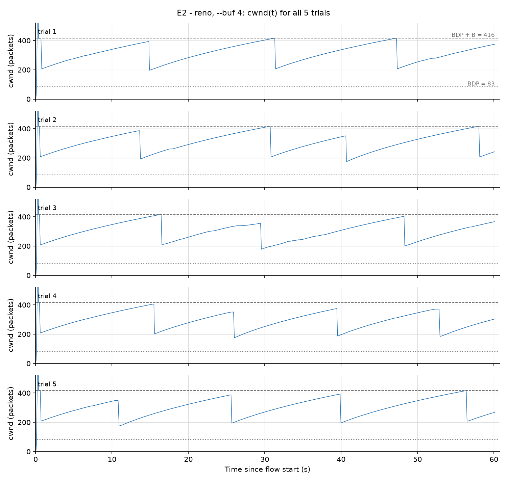
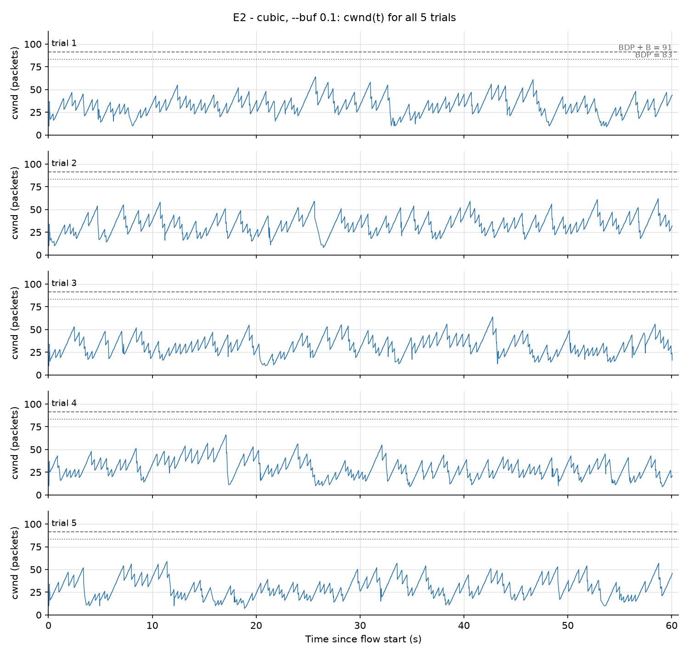
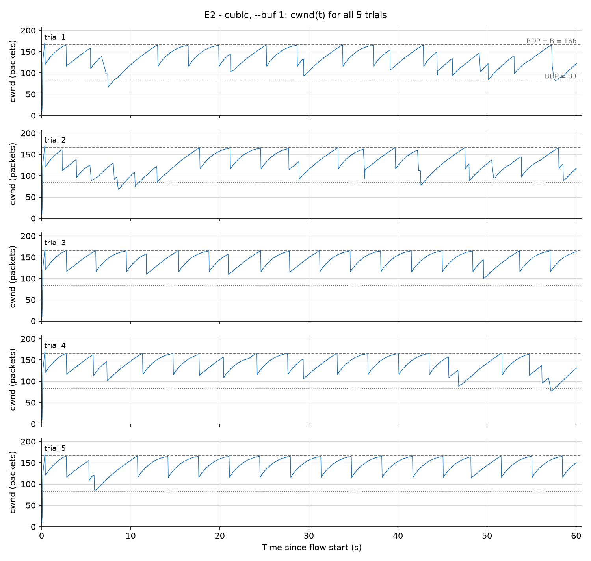
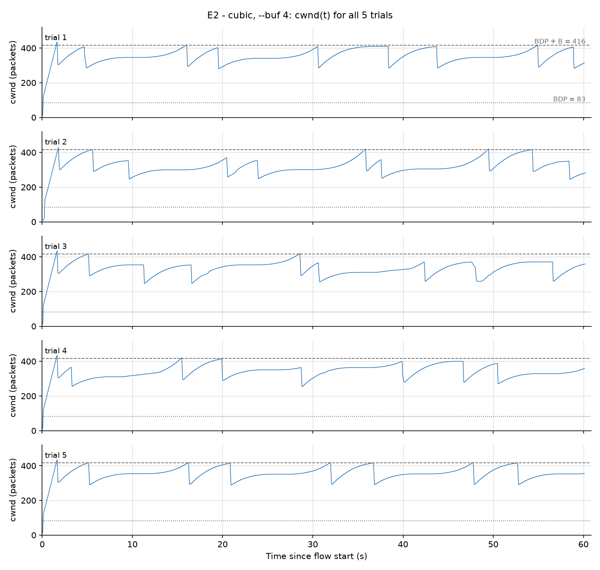
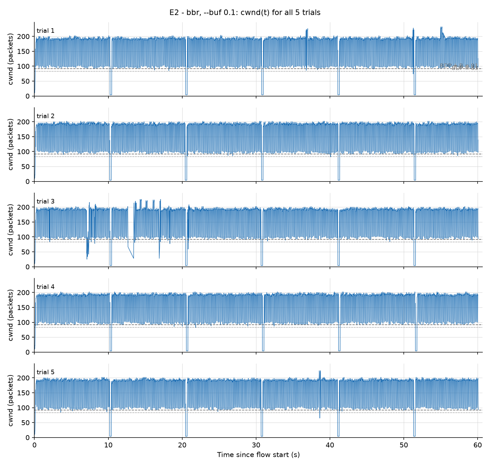
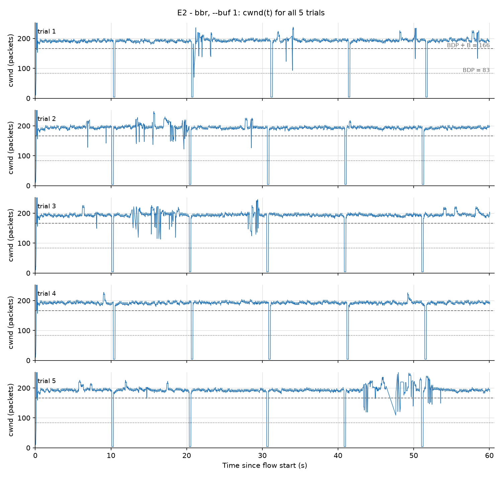
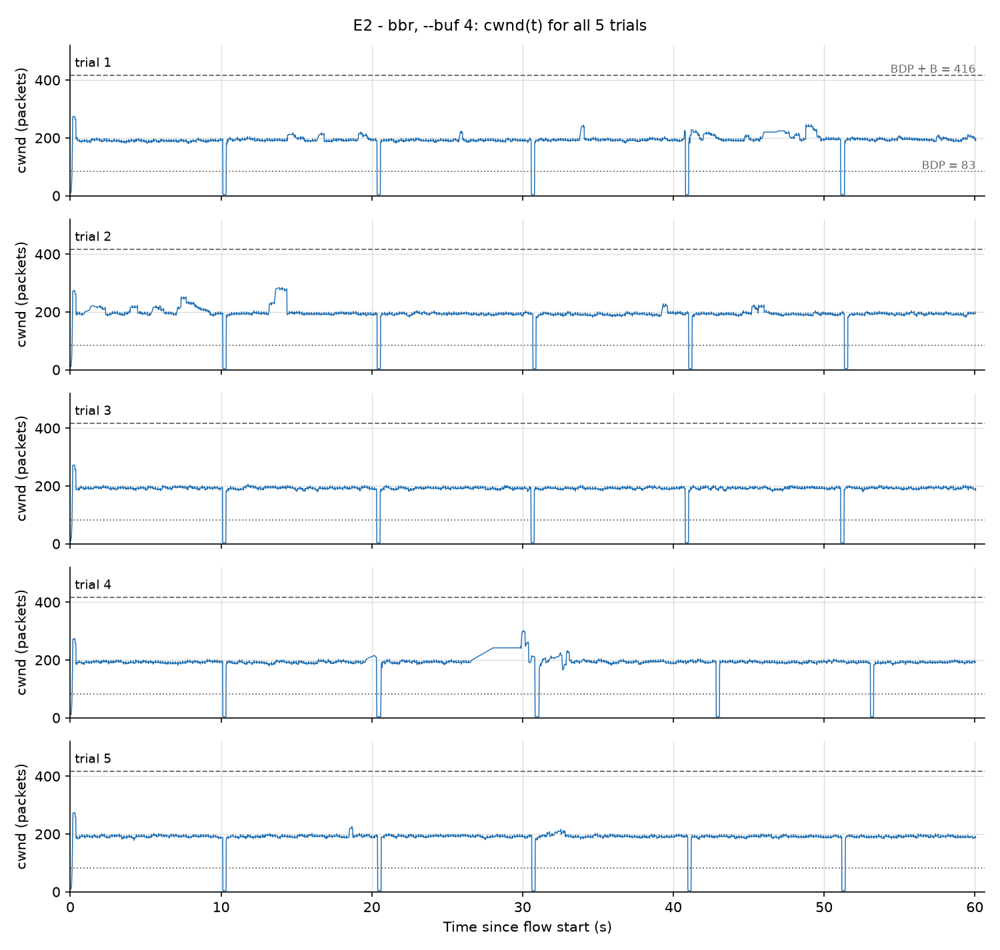

## Setup

### Environment

Mininet runs on Linux only. If you use macOS or Windows, use [Multipass](https://canonical.com/multipass) to run an Ubuntu VM:

```bash
multipass launch --name cc --cpus 2 --memory 4G --disk 10G   # create the VM
multipass shell cc                                           # open a shell inside it
multipass transfer dumbbell.py cc:                           # copy a file from your machine into the VM
```

Inside the Ubuntu VM, install the tools and load BBR:

```bash
sudo apt update
sudo apt install mininet openvswitch-switch iperf3 ethtool
sudo modprobe tcp_bbr                                # load the BBR kernel module (Reno and CUBIC are built in)
sysctl net.ipv4.tcp_available_congestion_control    # must list reno cubic bbr
```

### Apple Silicon Macs only: keep the VM's CPUs awake

When a VM CPU goes idle, macOS wakes it late, so netem's delays (and BBR's pacing) fire tens of milliseconds late. Before using Mininet, open a second VM shell (`multipass shell cc`), run this, and leave that shell open:

```bash
for i in $(seq $(nproc)); do chrt -i 0 sh -c 'while :; do :; done' & done   # one busy loop per VM CPU
```

`chrt -i 0` runs the loops at the lowest scheduling priority, so they only use CPU time that nothing else wants. Stop them when you are done:

```bash
pkill -f 'while :'
```

### Experiment

### 1. Start the network

```bash
sudo python3 dumbbell.py --bw 50 --delay 10ms --buf 1
```

- To change --bw, --delay, --delay1, --buf, or --loss, type exit and start the script again with the new options.
- If the script crashes, clean up before restarting:
  ```bash
  sudo mn -c
  sudo pkill iperf3
  ```

### 2. One trial = two commands

Every single-flow trial is the same two commands typed at the mininet> prompt.

- Example: Reno, trial 1 of E1:
  - mininet> snd0 timeout 65 sh -c 'while :; do date +%s.%N; ss -tin dst 10.0.0.101:5201; sleep 0.01; done' > e1_b1_reno_t1_ss.txt &
  - mininet> snd0 iperf3 -c 10.0.0.101 -C reno -t 60 -i 0.5 -J --logfile e1_b1_reno_t1.json

## E1 — Single flow, cwnd(t)

### A. Reno

### 1. Regenerating the Plot

**Requirements:** Python ≥ 3.8 and matplotlib.

Install matplotlib:

```bash
pip install matplotlib
```

Run the following command from the `project-cc` directory. It reads every
`data/e1/e1_b1_reno_t*_ss.txt` file and writes `plots/e1_reno_cwnd_all.png`:

```bash
python3 e1/analyze_e1.py --algo reno
```

#### Extraction Rules

- **Time origin (`t0`):** The first timestamp in the file.
- **Sample:** One timestamp and all sockets listed after it, up to the next timestamp.
- **Data socket:** The connection identified by its local and peer addresses and ports with the largest `bytes_acked` value across the entire file. This connection is then tracked in every sample, including early samples before it has acknowledged much data.
- **Missing data:** Samples without the data socket are dropped. Missing `cwnd` values are never replaced with zero or interpolated.
- **Time precision:** `time_s = timestamp − t0` is computed using `decimal.Decimal` to preserve the recorded timestamp precision.

### 2. Plot

The dashed line marks BDP + B = 166 packets (the point where the queue overflows). The dotted line marks BDP = 83 packets.


### 3. Steady-State Throughput: Mean and Standard Deviation

For each trial, steady-state throughput is calculated by averaging the per-interval throughput values, excluding intervals that start before 5 seconds. The mean and sample standard deviation are then calculated across the five trial results.

Run:

```bash
python3 e1/throughput_e1.py --algo reno
```

Output:

```text
t1: 47.57 Mbps
t2: 46.28 Mbps
t3: 46.27 Mbps
t4: 46.08 Mbps
t5: 45.66 Mbps
Mean ± SD: 46.37 ± 0.71 Mbps
```

Link utilization is calculated as:

$$
U = \frac{\bar{x}}{C} \times 100\%
  = \frac{46.37}{50} \times 100\%
  = \boxed{92.74\%}
$$

Here, $\bar{x}$ is the mean steady-state throughput and $C$ is the bottleneck capacity, both in Mbps.

Reno achieved a steady-state throughput of **46.37 ± 0.71 Mbps** across five trials, equivalent to **92.74%** of the 50 Mbps bottleneck capacity. This result is consistent with application throughput being lower than link capacity due to protocol overhead and congestion control behavior.

### 4. Trends and Deviations

**Setup and model.** C = 50 Mbps, RTT_min = 2 × 10 ms = 20 ms, so BDP = 50 Mbps × 20 ms / (1500 B × 8) ≈ 83 packets, and the buffer is B = 1 BDP = 83 packets. In the model, a single Reno flow fills the queue when cwnd reaches BDP + B = 166 packets. The next loss halves cwnd to 83 = BDP. Reno then adds 1 packet per RTT until the queue overflows again.

#### Trends

1. **AIMD sawtooth between BDP and BDP + B.** After slow start, cwnd rises to 166 packets, halves to 83, and repeats. In trial 1, 17 of the 19 cycles after slow start peak at exactly 166 and fall to exactly 83, the values the drop-tail model predicts.

2. **Each ramp curves (concave) instead of rising in a straight line.** A straight ramp assumes a constant RTT. Here, every packet above the BDP waits in the bottleneck queue. RTT therefore grows from 20 ms at cwnd = 83 to 40 ms at cwnd = 166, a full queue being 83 packets × 0.24 ms = 20 ms. Reno adds one packet per RTT, so in packets per second it grows half as fast at the top of a ramp as at the bottom.

3. **The sawtooth period is about 2.6 s.** Integrating dW/dt = 1/RTT(W), with RTT(W) = RTT_min × W / BDP, from 83 to 166 gives a period of RTT_min / (2·BDP) × (166² − 83²) ≈ 2.48 s.

#### Deviations

- **Many losses happened earlier than expected.** In some cycles, cwnd dropped before reaching the predicted 166 packets. Trial 1 had only 2 early losses, while trials 2–5 had 8–15 and lower throughput.

  VM scheduling delays may have caused packets to arrive in bursts and fill the queue early. Trials 4–5 each had 16 sampler gaps longer than 50 ms, compared with none in trial 1. This supports scheduling delays as a possible explanation, but does not prove they caused the losses. Cycle counts also cover different durations, so they are not directly comparable across all trials.

- **Troughs below 83 packets are still Reno's normal halving.** Each deep trough is half of the lower peak before it: 103 → 52 and 107 → 53 in trial 4, and 118 → 59 and 127 → 64 in trial 5. Reno behaves correctly; only the point where loss happens moves. While cwnd is below the BDP the queue is empty and the link is briefly idle, so the trials with more of these cycles have lower throughput.

- **The empty stretch at the left of each panel comes from how the sampler was timed.** `t = 0` is the sampler's first timestamp, not the start of the flow. The sampler started 5–17 s before iperf3: about 5 s for trials 3–5, and 15–17 s for trials 1–2. Trials 4–5 were re-run with the sampler running for the whole flow, so they capture all 59–60 s of it. Trials 1–3 stopped early and cover only 48–50 s.

### B. Cubic

### 1. Regenerating the Plot

Run the following command from the `project-cc` directory. It reads every
`data/e1/e1_b1_cubic_t*_ss.txt` file and writes `plots/e1_cubic_cwnd_all.png`:

```bash
python3 e1/analyze_e1.py --algo cubic
```

The dashed line marks BDP + B = 166 packets (the point where the queue overflows). The dotted line marks BDP = 83 packets.



### 2. Throughput

```bash
python3 e1/throughput_e1.py --algo cubic
```

Output:

t1: 41.82 Mbps
t2: 46.92 Mbps
t3: 47.68 Mbps
t4: 46.36 Mbps
t5: 46.12 Mbps
Mean ± SD: 45.78 ± 2.29 Mbps

Link utilization is calculated as:

$$
U = \frac{\bar{x}}{C} \times 100\%
  = \frac{45.78}{50} \times 100\%
  = \boxed{91.56\%}
$$

### 3. Trends and Deviations

#### Trends

- **Reductions are ×0.7:** The cwnd typically goes 166 → 116 (Reno goes 166 → 83).
- **The ramps fit the cubic curve:** In clean cycles, cwnd stays on average within 0.7–1.8 packets of 0.4(t − 5)³ + 166.
- **The period is about 3.4 s, not K = 5 s.**

#### Deviations

- **Many losses came early:** We expected that every loss happens at about 166 packets. In some trials most losses happen early. Trial 1, for example, had 18 early losses and only 6 full ones. One likely reason is that the VM does not run at a perfectly steady speed. When it pauses for a moment, packets pile up and then leave all at once as a burst. A burst can fill the 83-packet queue before cwnd reaches 166. It can be seen that trial 1 has the most gaps and the most early losses, while trials 3 and 4 have almost no gap and few early losses.

- **Few clean cycles are clean:** We expected most cycles are clean, but trial 5 has only 4. A clean cycle needs two full losses in a row. One early loss breaks two cycles at once: the cycle it ends and the cycle it starts. In trial 5 the full losses are scattered between early ones, so few of them are back to back

- **cwnd sometimes falls below the BDP:** After a loss, we expected the BDP = 0.7 x 166 = 116 (>83). However, in some trials, cwnd falls to 62-75. It may be because of several losses happening close together, and each one multiplies cwnd by 0.7 again.

- **Cubic was not clearly better than Reno:** We expected that Cubic should beat Reno. However, we observed that results, on average, were about the same: CUBIC 46.26 Mbps vs Reno 46.37 Mbps. It may come from the 1st trial (41.82Mbps), which pulls CUBIC's average down.

### C. BBR

### 1. Regenerating the Plot

Run the following command from the `project-cc` directory. It reads every
`data/e1/bbr/e1_b1_bbr_t*_ss.txt` file and writes `plots/e1_bbr_cwnd_all.png`:

```bash
python3 e1/analyze_e1.py --algo bbr
```

The dashed line marks BDP + B = 166 packets (the point where the queue overflows). The dotted line marks BDP = 83 packets.


### 2. Throughput

```bash
python3 e1/throughput_e1.py --algo bbr
```

Output:

```text
t1: 46.31 Mbps
t2: 46.29 Mbps
t3: 43.65 Mbps
t4: 45.09 Mbps
t5: 45.90 Mbps
Mean ± SD: 45.45 ± 1.12 Mbps
```

Link utilization is calculated as:

$$
U = \frac{\bar{x}}{C} \times 100\%
  = \frac{45.45}{50} \times 100\%
  = \boxed{90.90\%}
$$

BBR achieved **45.45 ± 1.12 Mbps** across five trials, **90.90%** of the 50 Mbps bottleneck. That is a little lower than Reno (46.37 Mbps) and CUBIC (46.26 Mbps). The reasons are explained in the Deviations below.

### 3. Trends

- **No sawtooth: cwnd is almost flat:** after Startup, cwnd stays at about **190–196 packets** in all five trials. It does not climb and drop like Reno and CUBIC. BBR does not react to loss, so there is no "grow until loss, then cut" cycle. It sends at the measured link speed and keeps that steady.

- **ProbeBW gain cycling shows up exactly as expected:** We expected that in the 8-step cycle, gain 1.25 should take 1/8 of the time (12.5%), 0.75 another 1/8 (12.5%), and gain 1 the other 6/8 (75%). Here is what we observed:

  | pacing_gain | Expected | Measured (5 trials) |
  | ----------- | -------- | ------------------- |
  | 1.25        | 12.5%    | 12.4–13.1%          |
  | 0.75        | 12.5%    | 11.9–12.3%          |
  | 1           | 75%      | 74.8–75.7%          |

- **ProbeRTT dips every 10 seconds:** We expected that every 10 s, cwnd drops to 4 packets for about 200 ms. We observed that very trial has exactly **5 dips** (25 in total). These are the deep, narrow drops to the bottom of each panel.

- **BBR measures the link correctly and keeps the queue small:**
  - **BtlBw ≈ 48.2 Mbps** in every trial, not 50. The link counts full Ethernet frames (1514 bytes), but BBR counts only the TCP data in them (1448 bytes): 50 × 1448 / 1514 ≈ 47.8 Mbps, very close to 48.2.
  - **RTprop = 20.0 ms** in every trial, exactly 2 × 10 ms (receiving and sending).
  - **The RTT stays low:** the median RTT is **23.7–26.4 ms**, so the queue holds only about 4–6 ms of data, or about 15–25 packets. Reno and CUBIC filled the whole 83-packet queue, so their RTT went up to about 40 ms. **Low delay is BBR's main advantage.**

### 4. Deviations

- **cwnd is about 194, not 2 × BDP = 166:** We expected cwnd = 2 × BDP = 166 packets. We observed that cwnd sits at about **192–194 packets** (median) in every trial. It may because Linux BBR adds a small allowance on top of 2 × BDP. It covers packets that are sent in small batches and ACKs that arrive in bunches, which happens a lot in a VM.

- **Losses during steady state, and spikes in cwnd:** We expected that after Startup, BBR should lose almost nothing. However, some trials have many retransmissions after Startup, from 41 in trial 1 to 640 in trial 3. It may be because of the VM's pauses. When the VM stops for 100–500 ms, ACKs stop arriving and BBR's steady pacing breaks. When the VM wakes up, a burst of packets is sent at once. Here cwnd (≈194) is **larger** than what the link plus queue can hold (166), so cwnd cannot stop such a burst from overflowing the queue, and packets are lost.

- **BBR's throughput is a little lower than Reno's and CUBIC's:** We expected that BBR should use the link about as well as the others, but with a much shorter queue. However, BBR averages 45.45 Mbps, compared with 46.37 (Reno) and 46.26 (CUBIC). There are twom main reasons:
  1. **ProbeRTT costs time:** for about 0.21 s out of every ~10.2 s (about 2%), cwnd is only 4 packets and the link is mostly idle. That alone costs roughly 1 Mbps.
  2. **VM pauses:** the noisiest trials lose the most. Trial 3 (34 gaps) has the lowest throughput, 43.65 Mbps. The two quietest trials (1 and 2) reach 46.3 Mbps, about the same as Reno and CUBIC.

## E2 — Vary B / BDP

E2 repeats E1's single-flow trials with three buffer sizes, `--buf 0.1`, `--buf 1` and `--buf 4`, for each algorithm. For each one it measures the **queueing delay** and the **link utilization U**, to show the trade-off between the two.

**What we expect** (C = 50 Mbps, RTT_min = 20 ms, BDP = 83 packets):

| `--buf` | B (packets) | Predicted peak delay B / C = buf × RTT_min |
| ------- | ----------- | ------------------------------------------ |
| 0.1     | 8           | about 2 ms                                 |
| 1       | 83          | about 20 ms                                |
| 4       | 333         | about 80 ms                                |

- **Reno and CUBIC** (loss-based) keep growing cwnd until the buffer overflows, so their delay climbs toward B / C again and again (_bufferbloat_). With `--buf 0.1` they should fall short of U ≈ 100%, because after each loss cwnd drops below the BDP and the link sits partly idle.
- **BBR** should keep the queue near 0 for every buffer size.

**Measuring queueing delay.** Queueing delay = `rtt` from each `ss` sample − RTT_min, using the samples from 5 s to 60 s of the flow. RTT_min = 20.00 ms, the smallest `minrtt` reported by ss (the RTT with an empty queue). We report the **mean** and the **95th percentile (p95)**. The p95 is close to the peak, which is what B / C predicts.

### A. Reno

### 1. Running the Plots

```bash
python3 e2/analyze_e2.py --algo <algo> --buf <number>

python3 e2/analyze_e2.py --algo reno --buf 0.1
```

In the cwnd plots, the dashed line marks BDP + B (where the queue overflows) and the dotted line marks BDP = 83 packets.

**`--buf 0.1`** (B = 8 packets, BDP + B = 91, B / C = 1.9 ms)



**`--buf 1`** (B = 83 packets, BDP + B = 166, B / C = 19.9 ms)



**`--buf 4`** (B = 333 packets, BDP + B = 416, B / C = 79.9 ms)



### 2. Throughput and Queueing Delay

The same commands also print, for each trial, the throughput (iperf3 intervals starting at 5 s or later, same as E1), U = x / C, and the queueing delay.

`--buf 0.1`:

```text
trial  throughput     U   mean delay  p95 delay  retransmits
t1      24.61 Mbps  49.2%    0.50 ms    1.18 ms       286
t2      22.67 Mbps  45.3%    0.61 ms    1.35 ms       487
t3      22.88 Mbps  45.8%    0.55 ms    1.27 ms       241
t4      21.25 Mbps  42.5%    0.75 ms    1.49 ms       432
t5      25.03 Mbps  50.1%    0.50 ms    1.22 ms       213

Mean ± SD throughput: 23.29 ± 1.54 Mbps, U = 46.58%
Mean queueing delay: 0.58 ms, p95: 1.30 ms (predicted peak 1.92 ms)
```

`--buf 1`:

```text
trial  throughput     U   mean delay  p95 delay  retransmits
t1      47.85 Mbps  95.7%   11.01 ms   19.27 ms       209
t2      47.70 Mbps  95.4%   10.86 ms   19.21 ms       265
t3      45.56 Mbps  91.1%   10.93 ms   19.21 ms       276
t4      47.62 Mbps  95.2%   10.76 ms   19.19 ms       216
t5      47.13 Mbps  94.3%   10.85 ms   19.18 ms       222

Mean ± SD throughput: 47.17 ± 0.94 Mbps, U = 94.35%
Mean queueing delay: 10.88 ms, p95: 19.21 ms (predicted peak 19.92 ms)
```

`--buf 4`:

```text
trial  throughput     U   mean delay  p95 delay  retransmits
t1      46.66 Mbps  93.3%   58.17 ms   78.03 ms       456
t2      47.05 Mbps  94.1%   55.30 ms   77.67 ms       431
t3      42.80 Mbps  85.6%   60.34 ms   79.77 ms       444
t4      46.75 Mbps  93.5%   52.21 ms   73.41 ms       548
t5      47.00 Mbps  94.0%   54.13 ms   75.46 ms       468

Mean ± SD throughput: 46.05 ± 1.83 Mbps, U = 92.10%
Mean queueing delay: 56.03 ms, p95: 76.87 ms (predicted peak 79.92 ms)
```

**Summary: the trade-off.**

| `--buf` | Predicted peak B / C | Mean queueing delay | p95 queueing delay | Throughput        | U         |
| ------- | -------------------- | ------------------- | ------------------ | ----------------- | --------- |
| 0.1     | 1.9 ms               | 0.58 ms             | 1.30 ms            | 23.29 ± 1.54 Mbps | **46.6%** |
| 1       | 19.9 ms              | 10.88 ms            | 19.21 ms           | 47.17 ± 0.94 Mbps | **94.4%** |
| 4       | 79.9 ms              | 56.03 ms            | 76.87 ms           | 46.05 ± 1.83 Mbps | **92.1%** |

- **From 0.1 to 1:** a buffer 10× larger made the queueing delay about 19× larger, but doubled the throughput. This is a good trade.
- **From 1 to 4:** a buffer 4× larger made the queueing delay about 5× larger, but gave **no** extra throughput.

### 3. Trends

- **Delay matches the prediction:**

- **With `--buf 0.1`, the link is half empty:** cwnd stays below the BDP (83) almost the whole time, averaging about 42 packets. Since 42 / 83 ≈ 50%, that matches the measured U of 46.6%.

- **With `--buf 4`, the queue never empties:** After a loss, cwnd only drops to 416 / 2 = 208, which is still more than the BDP. So the delay never goes below about 22 ms. Each cycle is also much slower, about 16 s (the model predicts 15.6 s), so there are only 3–4 losses per run.

### 4. Deviations

- **U does not match the model:** At `--buf 0.1` we expected about 81% but got 46.6%, because Reno sends bursts and just 9 packets overflow the 8-packet buffer, so cwnd drops at about 52 instead of 91. At `--buf 4` we got 92.1%, a bit below `--buf 1` (94.4%), but only because trial 3 was slow; without it both are about 94%, near the 95.6% maximum.

### B. CUBIC

### 1. Running the Plots

In the cwnd plots, the dashed line marks BDP + B (where the queue overflows) and the dotted line marks BDP = 83 packets.

**`--buf 0.1`** (B = 8 packets, BDP + B = 91, B / C = 1.9 ms)



**`--buf 1`** (B = 83 packets, BDP + B = 166, B / C = 19.9 ms)



**`--buf 4`** (B = 333 packets, BDP + B = 416, B / C = 79.9 ms)



### 2. Throughput and Queueing Delay

`--buf 0.1`:

```text
trial  throughput     U   mean delay  p95 delay  retransmits
t1      17.87 Mbps  35.7%    0.78 ms    1.48 ms       486
t2      18.78 Mbps  37.6%    0.65 ms    1.32 ms       404
t3      17.71 Mbps  35.4%    0.76 ms    1.49 ms       587
t4      16.32 Mbps  32.6%    0.90 ms    1.97 ms       537
t5      16.38 Mbps  32.8%    0.85 ms    1.75 ms       601

Mean ± SD throughput: 17.41 ± 1.05 Mbps, U = 34.82%
Mean queueing delay: 0.79 ms, p95: 1.60 ms (predicted peak 1.92 ms)
```

`--buf 1`:

```text
trial  throughput     U   mean delay  p95 delay  retransmits
t1      45.81 Mbps  91.6%   12.73 ms   19.34 ms       416
t2      45.41 Mbps  90.8%   12.14 ms   19.20 ms       444
t3      47.78 Mbps  95.6%   14.77 ms   19.43 ms       111
t4      46.75 Mbps  93.5%   13.95 ms   19.40 ms       225
t5      47.47 Mbps  94.9%   15.08 ms   19.47 ms        82

Mean ± SD throughput: 46.64 ± 1.02 Mbps, U = 93.29%
Mean queueing delay: 13.73 ms, p95: 19.37 ms (predicted peak 19.92 ms)
```

`--buf 4`:

```text
trial  throughput     U   mean delay  p95 delay  retransmits
t1      46.34 Mbps  92.7%   67.21 ms   78.99 ms       246
t2      44.22 Mbps  88.4%   61.33 ms   80.39 ms       138
t3      41.90 Mbps  83.8%   67.73 ms   80.96 ms       124
t4      45.36 Mbps  90.7%   66.48 ms   78.78 ms       246
t5      47.87 Mbps  95.7%   66.11 ms   79.23 ms        47

Mean ± SD throughput: 45.14 ± 2.25 Mbps, U = 90.27%
Mean queueing delay: 65.77 ms, p95: 79.67 ms (predicted peak 79.92 ms)
```

**Summary: the trade-off.**

| `--buf` | Predicted peak B / C | Mean queueing delay | p95 queueing delay | Throughput        | U         |
| ------- | -------------------- | ------------------- | ------------------ | ----------------- | --------- |
| 0.1     | 1.9 ms               | 0.79 ms             | 1.60 ms            | 17.41 ± 1.05 Mbps | **34.8%** |
| 1       | 19.9 ms              | 13.73 ms            | 19.37 ms           | 46.64 ± 1.02 Mbps | **93.3%** |
| 4       | 79.9 ms              | 65.77 ms            | 79.67 ms           | 45.14 ± 2.25 Mbps | **90.3%** |

- **From 0.1 to 1:** the delay went up about 17×, and the throughput went up about 2.7×. CUBIC needs a big enough buffer even more than Reno does.
- **From 1 to 4:** the delay went up about 5×, with **no** extra throughput. Same as Reno: the extra buffer only adds delay.

### 3. Trends

- **Delay matches the prediction:** the p95 delay is close to B / C for all three buffers (1.6, 19.4 and 79.7 ms). Like Reno, CUBIC fills the queue whatever its size.

- **CUBIC keeps the queue fuller than Reno:** the mean delay is 13.7 ms at `--buf 1` (Reno: 10.9) and 65.8 ms at `--buf 4` (Reno: 56.0). CUBIC only cuts cwnd to 70% after a loss (Reno cuts to 50%), and its curve stays flat near the top for a long time, so the queue rarely drains.

- **Every loss cuts cwnd to about 70%:** the median trough ÷ peak is **0.70** at `--buf 1` and `--buf 4`, and 0.68 at `--buf 0.1`.

- **`--buf 4` shows the whole cubic curve:** this is the only buffer size where the plateau and the convex "probing" part both appear. The cycles alternate:
  - a **short cycle** (about 4.6–4.9 s): after a loss at 416, cwnd drops to 291 and climbs back toward 416, then loses again at about 412–417;
  - a **long cycle** (about 11 s): that second loss is just below the previous peak, so Linux lowers its target to 0.85 × 414 ≈ 350 (_fast convergence_). cwnd rises to 350, stays flat for several seconds, then speeds up again (the convex part) until it hits 416.

  Trial 5 shows this most clearly. The model predicts the long cycle takes about 10.8 s; we measured 11.0–11.2 s.

- **With `--buf 0.1`, CUBIC grows at half Reno's speed:** RTT is only about 20 ms here, so CUBIC uses its Reno-friendly window, which grows by about 0.53 packets per RTT. We measured **25 packets/s**, close to 0.53 / 20.6 ms ≈ 26, and about half of Reno's 48.5 packets/s.

### 4. Deviations

- **U at `--buf 0.1` is even lower than Reno's:** we got 34.8% (Reno: 46.6%). Just like Reno, bursts overflow the 8-packet buffer early: cwnd never reaches 91 and usually drops at about 38 packets. CUBIC also grows back half as fast as Reno, so its average cwnd is only about 32 packets. 32 / 83 ≈ 39%, close to the measured U.

- **Noisy trials have lower U:** at `--buf 4`, trial 5 had no sampler gaps and reached 95.7%, while trial 3 had 51 gaps and only 83.8%. At `--buf 1`, the two quietest trials (3 and 5) reached about 95%, while the two noisiest (1 and 2) had about 4× more retransmissions and about 91%. As in E1, VM pauses most likely cause early losses.

- **Many losses at `--buf 4` happen well before 416:** in trials 2 and 3 several peaks are only 350–370. Each early loss lowers the target again (fast convergence), so cwnd plateaus lower (about 300 instead of 350). Even so, cwnd never gets close to the BDP, so the link stays full.

### C. BBR

### 1. Running the Plots

In the cwnd plots, the dashed line marks BDP + B (where the queue overflows) and the dotted line marks BDP = 83 packets.

**`--buf 0.1`** (B = 8 packets, BDP + B = 91, B / C = 1.9 ms)



**`--buf 1`** (B = 83 packets, BDP + B = 166, B / C = 19.9 ms)



**`--buf 4`** (B = 333 packets, BDP + B = 416, B / C = 79.9 ms)



### 2. Throughput and Queueing Delay

`--buf 0.1`:

```text
trial  throughput     U   mean delay  p95 delay  retransmits
t1      46.42 Mbps  92.8%    0.71 ms    1.98 ms      9174
t2      46.46 Mbps  92.9%    0.68 ms    1.98 ms      9075
t3      45.32 Mbps  90.6%    0.88 ms    2.00 ms      9394
t4      46.48 Mbps  93.0%    0.68 ms    1.98 ms      9068
t5      46.35 Mbps  92.7%    0.69 ms    1.97 ms      9131

Mean ± SD throughput: 46.21 ± 0.50 Mbps, U = 92.41%
Mean queueing delay: 0.73 ms, p95: 1.98 ms (predicted peak 1.92 ms)
```

`--buf 1`:

```text
trial  throughput     U   mean delay  p95 delay  retransmits
t1      45.77 Mbps  91.5%    5.52 ms   12.36 ms       347
t2      46.18 Mbps  92.4%    6.15 ms   15.11 ms       541
t3      45.39 Mbps  90.8%    6.31 ms   14.93 ms       752
t4      46.80 Mbps  93.6%    4.06 ms    7.74 ms       217
t5      44.41 Mbps  88.8%    6.13 ms   14.83 ms       545

Mean ± SD throughput: 45.71 ± 0.89 Mbps, U = 91.42%
Mean queueing delay: 5.63 ms, p95: 12.99 ms (predicted peak 19.92 ms)
```

`--buf 4`:

```text
trial  throughput     U   mean delay  p95 delay  retransmits
t1      44.93 Mbps  89.9%    8.14 ms   20.77 ms         8
t2      46.14 Mbps  92.3%    6.91 ms   19.66 ms         0
t3      46.82 Mbps  93.6%    3.97 ms    7.67 ms         0
t4      42.77 Mbps  85.5%    5.16 ms    8.20 ms         3
t5      46.63 Mbps  93.3%    4.77 ms   10.69 ms         0

Mean ± SD throughput: 45.46 ± 1.67 Mbps, U = 90.92%
Mean queueing delay: 5.79 ms, p95: 13.40 ms (predicted peak 79.92 ms)
```

**Summary: the trade-off.**

| `--buf` | Predicted peak B / C | Mean queueing delay | p95 queueing delay | Throughput        | U         | Retransmits per run |
| ------- | -------------------- | ------------------- | ------------------ | ----------------- | --------- | ------------------- |
| 0.1     | 1.9 ms               | 0.73 ms             | 1.98 ms            | 46.21 ± 0.50 Mbps | **92.4%** | about 9,000         |
| 1       | 19.9 ms              | 5.63 ms             | 12.99 ms           | 45.71 ± 0.89 Mbps | **91.4%** | 217–752             |
| 4       | 79.9 ms              | 5.79 ms             | 13.40 ms           | 45.46 ± 1.67 Mbps | **90.9%** | 0–8                 |

- **BBR has no real trade-off:** U stays at about 91–92% for every buffer size, and the mean delay stays under 6 ms even when the buffer could hold 80 ms.
- **The cost is loss at `--buf 0.1`:** about 9,000 retransmissions per run, roughly 4% of the packets sent.

### 3. Trends

- **BBR keeps the queue small, as predicted:** at `--buf 1` and `--buf 4` the mean delay is about the same (5.6 and 5.8 ms), even though B / C goes from 20 ms to 80 ms. Reno and CUBIC filled whatever buffer they had (56 and 66 ms at `--buf 4`). BBR sends at the measured link rate and keeps only about 97–105 packets in flight (BDP + 15–20), so it never uses the extra buffer.

- **cwnd looks the same for every buffer:** about 190–194 packets, with a ProbeRTT dip to 4 packets every **10.2–10.5 s** (5 dips per run). BBR sets cwnd from its estimates (2 × BDP plus a small allowance), not from the buffer size.

- **U does not depend on the buffer:** BBR does not cut its rate after a loss, so a small buffer does not leave the link idle. At `--buf 0.1` BBR gets 92.4%, against 46.6% for Reno and 34.8% for CUBIC.

### 4. Deviations

- **At `--buf 0.1`, BBR loses packets every gain cycle:** we expected BBR to keep the queue near empty and avoid loss. But the 1.25 probe phase sends 25% faster for one RTT, which adds about 0.25 × 83 ≈ 20 extra packets, more than the 8-packet buffer can hold. So every 8-phase gain cycle (about 8 × 20.6 ms = 165 ms) ends with a burst of losses: the plot shows cwnd dropping from about 190 to about 95 **6.1 times per second**, exactly once per cycle. BBR ignores these losses and keeps sending at the link rate, so U stays high, but this would be unfair to Reno or CUBIC flows sharing the link.

- **The gain-cycle shares change at `--buf 0.1`:** at `--buf 1` and `--buf 4` the 1.25 and 0.75 phases each take about 12.5% of the time, as expected. At `--buf 0.1` the 1.25 phase takes about 17% and the 0.75 phase only about 7%. After the losses, the number of packets in flight is already at or below the BDP, so the 0.75 "drain" phase has nothing to drain and ends early.

- **Startup overshoots less at `--buf 0.1`:** cwnd peaks at 196–200 instead of about 274, because the small buffer causes losses earlier in Startup.

- **Noisy trials have lower U:** trial 4 of `--buf 4` (85.5%) and trial 5 of `--buf 1` (88.8%) had VM freezes of about 1.3–1.5 s, where iperf3 measured 0 Mbps for over a second. In trial 4 of `--buf 4`, that freeze also delayed one ProbeRTT dip (12.0 s apart instead of 10.2 s).
