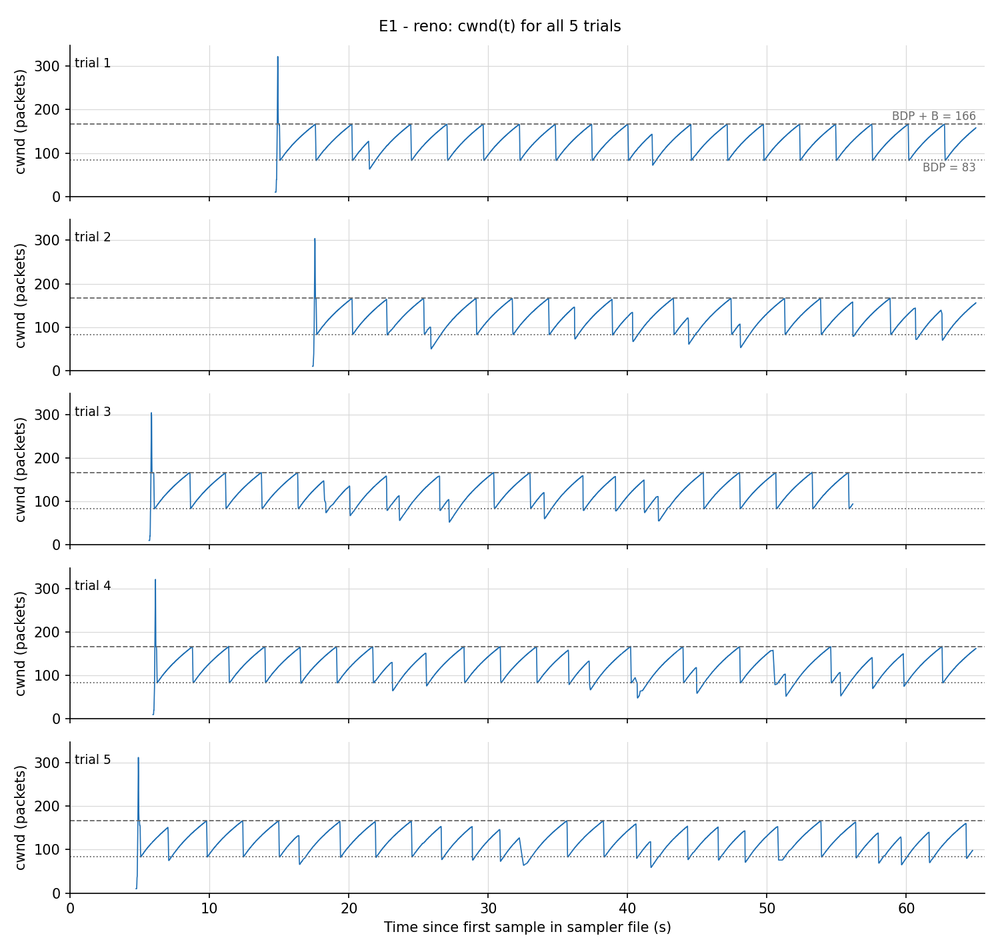

## Setup

### Environment

Mininet runs on Linux only. If you use macOS or Windows, use [Multipass](https://canonical.com/multipass) to run an Ubuntu VM:

```bash
multipass launch --name cc --cpus 2 --memory 4G --disk 10G   # create the VM
multipass shell cc                                           # open a shell inside it
multipass transfer dumbbell.py cc:                           # copy a file from your machine into the VM
```

Inside the Ubuntu VM, install the tools and load BBR:

```bash
sudo apt update
sudo apt install mininet openvswitch-switch iperf3 ethtool
sudo modprobe tcp_bbr                                # load the BBR kernel module (Reno and CUBIC are built in)
sysctl net.ipv4.tcp_available_congestion_control    # must list reno cubic bbr
```

### Apple Silicon Macs only: keep the VM's CPUs awake

When a VM CPU goes idle, macOS wakes it late, so netem's delays (and BBR's pacing) fire tens of milliseconds late. Before using Mininet, open a second VM shell (`multipass shell cc`), run this, and leave that shell open:

```bash
for i in $(seq $(nproc)); do chrt -i 0 sh -c 'while :; do :; done' & done   # one busy loop per VM CPU
```

`chrt -i 0` runs the loops at the lowest scheduling priority, so they only use CPU time that nothing else wants. Stop them when you are done:

```bash
pkill -f 'while :'
```

## E1 — TCP Reno Congestion Window over a Bottleneck Link

### 1. Regenerating the Plot

**Requirements:** Python ≥ 3.8 and matplotlib.

Install matplotlib:

```bash
pip install matplotlib
```

Run the following command from the `project-cc` directory. It reads every
`data/e1/e1_b1_reno_t*_ss.txt` file and writes `plots/e1_reno_cwnd_all.png`:

```bash
python3 e1/analyze_e1.py
```

#### Extraction Rules

- **Time origin (`t0`):** The first timestamp in the file.
- **Sample:** One timestamp and all sockets listed after it, up to the next timestamp.
- **Data socket:** The connection identified by its local and peer addresses and ports with the largest `bytes_acked` value across the entire file. This connection is then tracked in every sample, including early samples before it has acknowledged much data.
- **Missing data:** Samples without the data socket are dropped. Missing `cwnd` values are never replaced with zero or interpolated.
- **Time precision:** `time_s = timestamp − t0` is computed using `decimal.Decimal` to preserve the recorded timestamp precision.

### 2. Plot

The dashed line marks BDP + B = 166 packets (the point where the queue overflows). The dotted line marks BDP = 83 packets.



### 3. Steady-State Throughput: Mean and Standard Deviation

For each trial, steady-state throughput is calculated by averaging the per-interval throughput values, excluding intervals that start before 5 seconds. The mean and sample standard deviation are then calculated across the five trial results.

Run:

```bash
python3 e1/throughput_e1.py
```

Output:

```text
t1: 47.57 Mbps
t2: 46.28 Mbps
t3: 46.27 Mbps
t4: 46.08 Mbps
t5: 45.66 Mbps
Mean ± SD: 46.37 ± 0.71 Mbps
```

Link utilization is calculated as:

$$
U = \frac{\bar{x}}{C} \times 100\%
  = \frac{46.37}{50} \times 100\%
  = \boxed{92.74\%}
$$

Here, $\bar{x}$ is the mean steady-state throughput and $C$ is the bottleneck capacity, both in Mbps.

Reno achieved a steady-state throughput of **46.37 ± 0.71 Mbps** across five trials, equivalent to **92.74%** of the 50 Mbps bottleneck capacity. This result is consistent with application throughput being lower than link capacity due to protocol overhead and congestion control behavior.

### 4. Trends and Deviations

**Setup and model.** C = 50 Mbps, RTT_min = 2 × 10 ms = 20 ms, so BDP = 50 Mbps × 20 ms / (1500 B × 8) ≈ 83 packets, and the buffer is B = 1 BDP = 83 packets. In the model, a single Reno flow fills the queue when cwnd reaches BDP + B = 166 packets. The next loss halves cwnd to 83 = BDP. Reno then adds 1 packet per RTT until the queue overflows again.

#### Trends

1. **AIMD sawtooth between BDP and BDP + B.** After slow start, cwnd rises to 166 packets, halves to 83, and repeats. In trial 1, 17 of the 19 cycles after slow start peak at exactly 166 and fall to exactly 83, the values the drop-tail model predicts.

2. **Each ramp curves (concave) instead of rising in a straight line.** A straight ramp assumes a constant RTT. Here, every packet above the BDP waits in the bottleneck queue. RTT therefore grows from 20 ms at cwnd = 83 to 40 ms at cwnd = 166, a full queue being 83 packets × 0.24 ms = 20 ms. Reno adds one packet per RTT, so in packets per second it grows half as fast at the top of a ramp as at the bottom.

3. **The sawtooth period is about 2.6 s.** Integrating dW/dt = 1/RTT(W), with RTT(W) = RTT_min × W / BDP, from 83 to 166 gives a period of RTT_min / (2·BDP) × (166² − 83²) ≈ 2.48 s.

#### Deviations

- **Some losses happened earlier than expected..** In some cycles, cwnd reached only 100–160 packets instead of the predicted 166 before dropping. One possible reason is that the VM does not process packets at a perfectly steady rate. Brief scheduling delays can cause packets to arrive in bursts and fill the queue early.

- **Troughs below 83 packets are still Reno's normal halving.** Each deep trough is half of the lower peak before it, for example 113 → 56 and 110 → 55. Reno itself is behaving correctly; only the point where loss happens has moved. While cwnd is below the BDP, the queue is empty and the link is briefly idle, which is why the trials with these cycles have lower throughput.

- **Empty stretches and missing tails come from how the sampler was timed.** `t = 0` is the sampler's first timestamp, not the start of the flow. The sampler started 5–17 s before iperf3, which is the empty stretch at the left of each panel. It also stopped before the 60 s flow ended:
  - trials 1–3 cover about 48–50 s of the flow;
  - trials 4–5 cover only about 11 s.

  The cycles visible in trials 4–5 have the same shape (peak 166, trough 83, period about 2.6 s) as trials 1–3. The throughput numbers in section 3 come from the full 60 s iperf3 run, so the sampler cutoff does not affect them. To capture the whole flow in a re-run, start the sampler immediately before iperf3 and run it for at least the test duration + 2 s.
